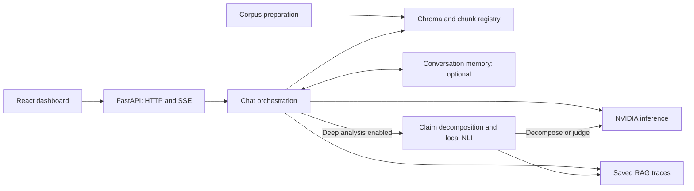
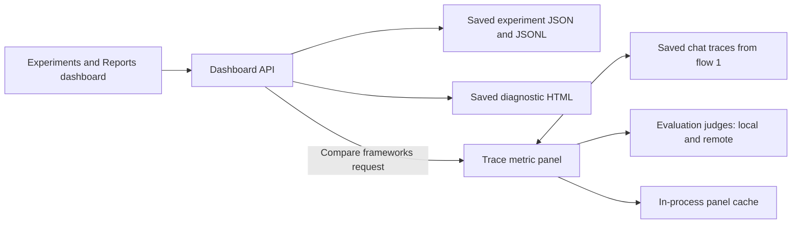

# X-RAG Diagnostic Framework

## Save failures as regression cases

Every saved answer has **Save as test case** and **Evidence debugger** actions.
Specify expected passage IDs, required facts, forbidden claims, and whether an
answer must refuse, may refuse, or must answer. Cases are written to
`eval/regression_cases/<id>.json`; saving a failing case does not turn it into
a passing baseline. Review and commit the case file to include it in PR checks.
The export includes the original answer and captured document passages, but
excludes recalled memory and conversation history.
For a context-dependent follow-up question, edit `snapshot.question` in the
case file into a standalone question before committing it.

**Debug → Regression cases** runs selected cases in three modes:

- **Regenerate:** current generation code and prompt, using captured document
  evidence. This isolates generation regressions without needing the corpus DB.
- **Retrieve:** current corpus retrieval plus generation. Requires the corpus
  index on the machine; expected IDs can require review after re-ingestion.
- **Snapshot:** checks the saved answer only, without regenerating it. This is
  fixture validation, not a check of current generation quality.

Literal fact matching normalizes case and whitespace, then checks phrases;
it includes quoted and negated occurrences. Optional local NLI checks semantic
support in the answer. Unavailable judgments fail the gate; ambiguous forbidden
claims are reported as uncertain and also fail. Refusal detection is a heuristic.
When refusal is allowed or required and detected, required facts are marked
not applicable; forbidden claims and expected evidence are still checked.

```powershell
.\venv\Scripts\python.exe -m scripts.run_regression_cases --validate
.\venv\Scripts\python.exe -m scripts.run_regression_cases --mode generate
.\venv\Scripts\python.exe -m scripts.run_regression_cases --mode retrieve
```

The runner exits nonzero on failed assertions, provider errors or unavailable
judgments and writes `.cache/regression-results.json`. The bundled case uses
a fictional document, not a real legal rule.

`.github/workflows/rag-regressions.yml` validates the assertion engine and
regenerates cases on relevant pull requests, uploading a JSON report. Set the
repository's **NVIDIA_API_KEY** Actions secret before enabling live checks.
Fork PRs do not receive secrets, so their live evaluation cannot report a pass.
The workflow uses `pull_request`, not privileged `pull_request_target`.
Its quality-gate pattern follows the [Promptfoo CI reference](https://www.promptfoo.dev/docs/integrations/ci-cd/),
using this project's runner rather than adding Promptfoo as a dependency.

## Debug sentence evidence and citations

The evidence explorer maps answer spans to extracted claims and the verifier's
best passage. Clicking a mapped claim opens the full captured passage and page;
PDF links serve only recorded sources within `data/` or `artifacts/`. The
current PDF may differ from the immutable captured text.

New deep analyses separately score each cited passage with local NLI. A claim
can be supported by one passage while its cited passage fails support. Citation
checks recognize `Chunk-ID`/`Chunk` markers, known bare chunk IDs and UUID-like
bracketed IDs; unrelated bracketed legal references are not silently treated
as chunk citations. A citation-only line after a sentence is attached to that
sentence for inspection. Legacy
traces show unavailable mappings/checks until **Analyze evidence and citations**
is run. That action can call NVIDIA for decomposition and ambiguous judging.
Sentence boundaries are approximate; unmapped sentences are never marked
supported merely because no claim was extracted.

New retrieval traces preserve ranked candidate text, source, page and scores,
including candidates omitted from the final prompt. IRCoT and agentic traces
collect candidates across retrieval calls. Older traces cannot reconstruct
discarded candidates from a changed index. Ranking does not itself establish
relevance. The debugger distinguishes observed support/citation issues from
uncertain judging and leaves retrieval failure unconfirmed without expected
evidence labels from a regression case.

## Replay and compare a saved trace

Open **Debug → Replay a trace**. Select a recent trace or paste any saved
trace ID. **Reuse original captured evidence** keeps the saved conversation
and document context fixed while you edit the generation model or system
prompt. **Retrieve again** lets you select a corpus, retrieval strategy and
top-K context limit against the current index. For multi-step strategies,
top-K caps final context; the strategy can make additional retrieval calls.

Each run saves a new trace linked to its original. The comparison shows both
answers, evidence additions/removals, claim verification, timing and settings.
Replay never writes conversation memory or overwrites the original trace.
The API is `POST /ui/trace/{trace_id}/replay`; send `mode: "frozen"` or
`"retrieve"`, optional `model`/`system_prompt`, and `verify_claims` (default
true). Retrieval options `arm`, `corpus`, and `top_k` require `retrieve` mode.

Replay uses the configured NVIDIA service and may incur inference usage.
New traces capture full evidence and structured messages. Older traces recover
these from the saved prompt and reject frozen replay when evidence is missing.
Provider model revisions are not pinned, so unchanged settings do not promise
identical outputs. Claim support scores describe evidence support, not factual
correctness; missing verification remains unmeasured.

## Start the dashboard, Archify and CodeCharta together

From the repository root in **PowerShell**, after the Python environment and
`.env` in [Quick Start](#quick-start) are ready, install the frontend dependencies
once with `npm --prefix frontend install`. Node.js must be on PATH. This local
checkout can also use the installed CodeCharta skill and its global visualization
package (the helper expects `$env:USERPROFILE\.codex\skills\codecharta`).
The source viewer is optional: when its script or saved explorer is absent,
the helper starts the dashboard and API normally. The saved Archify and
CodeCharta files described below are local artifacts excluded from Git.

```powershell
# Launch three hidden background processes; terminal can be closed afterward.
.\scripts\local_services.ps1 start

# Check HTTP readiness (the API can take longer to import its dependencies).
.\scripts\local_services.ps1 status

# Stop only the processes recorded by this helper.
.\scripts\local_services.ps1 stop
```

| Service | Open | Purpose |
|---|---|---|
| React dashboard | <http://127.0.0.1:5173> | Chat, graphs, experiments and reports |
| Dashboard API | <http://127.0.0.1:8010/docs> | FastAPI transport and interactive API docs |
| CodeCharta explorer | <http://127.0.0.1:8085/explorer.html> | Source map, metrics and component notes |

Logs and owned process IDs are in `.cache/local-services/`. An occupied port is
left alone; `stop` only stops a matching recorded PID and process start time.
Processes keep running after the assistant finishes and after closing the
terminal. Keep Windows awake: computer sleep or shutdown interrupts serving;
the helper does not automatically restart services after reboot. Starting these
services does not start an experiment run or rebuild the document index.

### Open the two saved Archify workflows

These are interactive **architecture diagrams** showing two application flows.
They can be opened as standalone HTML without running any server:

- [Live chat and evidence](.archify/architecture-saved-dashboard-20261007-145812/chat-pipeline.html)
- [Saved experiments and trace evaluation](.archify/architecture-saved-dashboard-20261007-145812/saved-results.html)

With the viewer running, open them at:

- <http://127.0.0.1:8085/.archify/architecture-saved-dashboard-20261007-145812/chat-pipeline.html>
- <http://127.0.0.1:8085/.archify/architecture-saved-dashboard-20261007-145812/saved-results.html>

Both saved diagrams have passing validation, delivery, provenance and automated
browser-check receipts beside their HTML files, dated 7 October 2026. They
describe the saved source snapshot; these receipts do not validate later code
changes. This startup command serves the existing artifacts.

### How the whole system fits together

**Flow 1: live chat and evidence.** `run_pipeline.py` prepares documents,
chunks and embeddings separately, writing the chunk registry and Chroma index.
The React dashboard sends a question and retrieval strategy to FastAPI on
8010. `src/chat_service.py` orchestrates retrieval (vector/BM25/hybrid,
reranking, or the optional iterative/graph strategies), recalls conversation
memory when enabled, and calls NVIDIA inference to generate an answer.
FastAPI streams the answer back using SSE. The service saves a RAG trace
containing the question, answer and evidence. Optional deep analysis decomposes
the answer into claims and checks them against evidence with local NLI;
decomposition and ambiguous judging can call remote inference. Enabled memory
stores interactions and supported facts for later turns.



**Flow 2: saved experiments and trace evaluation.** Experiments and Reports
use the same dashboard and API to browse files already under `artifacts/`.
The active experiment run is selected through `artifacts/experiments/active_run.json`;
legacy results use the base experiments directory. These endpoints read
manifests, summaries, JSONL records and diagnostic HTML; browsing does not
execute the experiment suite. The separate **Compare frameworks** action
evaluates a saved chat trace: it reuses persisted claim verification or computes
and persists missing verification, then computes a metric panel with local and
remote judges as needed. Panel results are cached in the API process and that
cache is lost on restart. The dashboard's RAGAS/RAGChecker/ARES-style scores
follow this project's definitions; the optional baseline benchmark commands
elsewhere in this README run the upstream frameworks separately.



The saved trace connects the two flows: chat creates evidence that diagnostics
can inspect later. Archify explains component responsibilities and data paths.
CodeCharta maps the implementation: buildings represent files, footprint is
real lines of code, and height/color reflect logic complexity. The saved map
measured 163 source files; its dependency edges cover frontend imports, not
Python runtime calls. Complexity helps choose what to inspect; it is not a bug
count. CodeCharta and Archify are local viewers, not services required by chat.

### Run or refresh the viewers manually

To serve the existing CodeCharta explorer and both Archify diagrams alone:

```powershell
node "$env:USERPROFILE\.codex\skills\codecharta\scripts\serve.mjs" . 8085
```

To regenerate CodeCharta metrics and embedded source snapshots after code changes
(requires the CodeCharta analysis tools, Java and Python script dependencies):

```powershell
python "$env:USERPROFILE\.codex\skills\codecharta\scripts\analyze.py" .
```

Archify has no required server. To regenerate a diagram from its saved JSON,
use the installed skill CLI; `finalize` runs its automated quality gates. For
changed application behavior, first revise the specification and source evidence
to match the code rather than only rerendering an old snapshot.

```powershell
$archifyCli = "$env:USERPROFILE\.codex\skills\archify\bin\archify.mjs"
$diagramDir = '.archify/architecture-saved-dashboard-20261007-145812'
node $archifyCli finalize architecture "$diagramDir/chat-pipeline.json" "$diagramDir/chat-pipeline.html" --repo-root . --quality showcase --json
node $archifyCli finalize architecture "$diagramDir/saved-results.json" "$diagramDir/saved-results.html" --repo-root . --quality showcase --json
```

Generated explorers and diagrams include source snapshots; keep the viewer local.

## Semantic repository index

Rebuild the searchable source map with `python scripts/build_semantic_index.py`.
See [index design and diagnostic flow](docs/SEMANTIC_INDEX.md) and
[generated metadata](docs/semantic_index.json) for symbols, dependencies, tests,
configuration, artifact references and API endpoints. No model loading or extra
dependencies are required.

The offline Python suite can be run with `XRAG_E2E_SKIP=1` when the two UI
servers are stopped (PowerShell: `$env:XRAG_E2E_SKIP='1'` before unittest).
The offline experiment integration test runs E1–E5; live studies E6 onward
remain separate benchmark runs. Chat transport checks use Node 24:
`node --test --test-isolation=none frontend/tests/api.test.mjs`.
For repeatable timing smoke checks, run `python -m scripts.benchmark_diagnostics`;
add `--local-model` to time cached NLI initialization and one-pair inference.
These synthetic checks do not measure remote LLM or live end-to-end latency.

Interrupted chat streams and HTTP failures now show a retryable error.
Unexpected backend chat exceptions return a reference ID; details stay in
developer logs. HTML diagnostic reports preserve trace text as escaped content.

## Run the React UI

## Run the dashboard (React)

From a fresh clone, create the Python environment, install dependencies, and
copy `.env.example` to `.env` with your `NVIDIA_API_KEY`. The chat dashboard
also needs an ingested corpus (`python run_pipeline.py` after adding PDFs to
`data/`). Keep your existing environment and corpus when updating this repo.

Windows PowerShell setup from the repository root:

```powershell
py -3.13 -m venv venv
.\venv\Scripts\python.exe -m pip install -r requirements.txt
Copy-Item .env.example .env
# Edit .env, add PDFs to data/, then ingest:
.\venv\Scripts\python.exe run_pipeline.py
```

Start these in two separate PowerShell terminals:

```powershell
# Terminal 1, repository root
.\venv\Scripts\python.exe run_api_ui.py

# Terminal 2, repository root
cd frontend
npm ci
npm run dev
```

Open <http://localhost:5173>. Keep both terminals running. The dashboard
backend uses port **8010**; the separate diagnostic API uses **8000**.
The alternative Streamlit dashboard runs with
`.\venv\Scripts\python.exe -m streamlit run ui/app.py` at port **8501**.


Two servers, both from the repo root. Requires the Python env set up (see
[Quick Start](#quick-start) below) and Node.js/npm installed.

```bash
# Terminal 1 -- backend (SSE chat + graph API) on http://127.0.0.1:8010
python run_api_ui.py

# Terminal 2 -- frontend on http://localhost:5173 (first run: cd frontend && npm install)
cd frontend
npm run dev
```

Open <http://localhost:5173>. **Chat** tab: pick a retrieval arm (`D_ircot`
for IRCoT, `F_graphrag`/`G_ircot_graph`/`H_agentic_graph` for GraphRAG) and
ask a question against the statutes or judgments corpus. **Graph** tab:
toggle between the RAG provenance graph and the interactive claude-mem memory
graph.

Run the test suites from the repo root:

```bash
python -m pytest tests/test_api_ui.py -v      # fast, no browser
python -m pytest tests/test_ui_e2e.py -v      # real Playwright e2e (needs both servers running)
```

---

## Project Overview

The X-RAG Diagnostic Framework evaluates RAG pipelines, traces failures,
and recommends fixes across retrieval, generation, and claim grounding.

## Install and evaluate an external RAG trace (feature branch)

The preserved dashboard is on `main` in
<https://github.com/BharathGelivi/capstone-rag-evaluation>. Portable package/API
support is on `feature/trace-api-nli`, ready to review and merge later. The
repository is private, so GitHub installation requires authenticated Git access.
Use a **separate Python 3.13 environment** for integration into another project:

```bash
python -m venv .venv
# Activate .venv, then:
python -m pip install "capstone-rag-evaluation @ git+https://github.com/BharathGelivi/capstone-rag-evaluation.git@feature/trace-api-nli"
```

Alternatively download/clone that branch and run `python -m pip install .`
from its root. This installs the Python evaluator and command line tools;
run the React dashboard from the source checkout using the instructions above.
The first evaluation downloads `cross-encoder/nli-deberta-v3-large` from
Hugging Face. Later runs reuse the cached weights. CPU works; CUDA is faster.

```python
from xrag import evaluate_trace

result = evaluate_trace({
    "question": "What is the capital of France?",
    "answer": "Paris is the capital of France.",
    "retrieved_chunks": [
        {"chunk_id": "doc-1", "text": "Paris is the capital of France."}
    ],
    "claims": ["Paris is the capital of France."]
})
print(result["verification"])
print(result["diagnostic_report"])
```

`evaluate_trace` accepts a dictionary, JSON string, or this framework's
`RAGTrace`. Canonical fields `generated_answer`, `retrieved_chunk_references`,
and `chunk_text` are also accepted. Supply original evidence text inline, or
in the canonical prompt's context blocks. Chunk IDs alone are rejected: the
package does not read your local corpus or `registry_path`. An empty evidence
list is accepted and reported as unverifiable. Inputs are not modified and no
artifacts, corpus, or memory files are written.

Supplied `claims` are used directly. Without them, the default treats answer
sentences as claims and reports that limitation. For atomic claim decomposition,
set `NVIDIA_API_KEY` in the process environment and call
`evaluate_trace(trace, claim_mode="llm")`; this sends the answer to NVIDIA.
Verification itself uses local NLI, with LLM judge escalation disabled.
The response includes per-claim verdicts, evidence and NLI scores, support and
contradiction rates, and the existing diagnostic report. Detailed stage
diagnoses need `configuration_snapshot`, `execution_statistics`, and
`pipeline_stage_status`; absent metadata limits what can be inferred. This
entry point does not compute the optional remote RAGAS/reference-answer metrics.
Reuse `TraceEvaluator()` or `evaluate_trace` across calls to retain one model.
Calls sharing an evaluator are serialized to bound model memory usage.

### Command line

```bash
xrag-evaluate examples/external_trace.json --output result.json
# Without --output, JSON is printed to stdout (model logs may appear too).
xrag-evaluate trace.json --claim-mode llm --output result.json
```

### Standalone HTTP API

```bash
xrag-api --port 8020
# Equivalent: python -m uvicorn xrag.api:app --host 127.0.0.1 --port 8020
```

Swagger: <http://127.0.0.1:8020/docs>. This service uses its own port and does
not access the dashboard's memory or corpus. Send an envelope containing your
trace, with optional `claim_mode` (`sentences` by default):

```python
import json
from urllib.request import Request, urlopen

trace = json.load(open("examples/external_trace.json", encoding="utf-8"))
request = Request("http://127.0.0.1:8020/evaluate",
                  data=json.dumps({"trace": trace}).encode(),
                  headers={"Content-Type": "application/json"})
with urlopen(request, timeout=300) as response:
    result = json.load(response)
```

Invalid traces return HTTP 422. Model/runtime failures return HTTP 500 with
a reference ID. `GET /health` checks service availability without loading the
NLI model. Run one worker to keep one model instance; each additional worker
loads its own weights. The original `run_api.py` `/analyze` API remains available
for the existing corpus-based workflow and persists its usual artifacts.

Package/API checks: `python -m pytest tests/test_trace_package.py -q`.
Package metadata follows [setuptools' pyproject configuration](https://setuptools.pypa.io/en/latest/userguide/pyproject_config.html),
and request validation uses [FastAPI request bodies](https://fastapi.tiangolo.com/tutorial/body/).

---

## Quick Start

Get the chat UI running from a fresh clone. Windows paths shown; on
macOS/Linux use `venv/bin/` instead of `venv\Scripts\`.

### 1. Create the environment

```bash
py -3.13 -m venv venv
venv\Scripts\pip install -r requirements.txt
```

### 2. Add your API key

Copy `.env.example` to `.env` and set the NVIDIA key — this is the only key the
core pipeline needs:

```ini
NVIDIA_API_KEY=nvapi-...
```

Get a free one at <https://build.nvidia.com/> (no credit card). All generation,
claim decomposition, and judging route through the NVIDIA NIM
OpenAI-compatible endpoint — see `configs/models.py`.

### 3. Enable your GPU (strongly recommended)

`pip install -r requirements.txt` installs a **CPU-only** build of torch. It
works, but claim verification costs 30–115 s *per claim* instead of ~3 s. Check
what you have:

```bash
venv\Scripts\python -c "import torch; print(torch.__version__, torch.cuda.is_available())"
```

If it prints `+cpu` or `False` and you have an NVIDIA card, install the CUDA
wheel matching your torch version:

```bash
venv\Scripts\pip install --index-url https://download.pytorch.org/whl/cu126 "torch==2.13.0+cu126"
```

Confirm the pipeline sees it:

```bash
venv\Scripts\python -c "from src.device import describe_device; print(describe_device())"
```

Full details, VRAM budget, and measured numbers: **`docs/gpu_setup.md`**.

### 4. Ingest your documents

Put PDFs in `data/`, then build the chunk registry and vector store. Re-run this
whenever the source documents change:

```bash
venv\Scripts\python run_pipeline.py
```

This writes `artifacts/chunk_registry.json` and `db/chroma/`. It downloads the
embedding and reranker models on first run.

### 5. Launch the chat UI

```bash
venv\Scripts\python -m streamlit run ui/app.py
```

Opens at <http://localhost:8501>.

---

## Using the App

A ChatGPT-style interface over your corpus, with the diagnostic pipeline
attached to every answer.

**Sidebar**

| Control | What it does |
|---|---|
| **➕ New Session** | Start a fresh conversation. Sessions persist across restarts. |
| **🧠 Memory** | Semantic recall of past turns, including from other sessions. |
| **⚡ Stream Answers** | Render tokens as they arrive. Same total time; first token in ~1s instead of a 20–70s blank wait. |
| **🔬 Deep Analysis** | Extract atomic claims and verify each against retrieved chunks with an NLI model. Defaults **on** with a GPU, **off** on CPU (where it adds minutes per turn). |
| **🐛 Debug Mode** | Show fusion scores, the raw trace, and the exact prompt sent to the model. |
| **📊 Details Panel** | Toggle the right-hand inspector. |
| **Device** | Shows whether models are on GPU or CPU — a CPU-only torch install is visible here. |

**Details panel tabs** — Chunks (what was retrieved, with dense/sparse/RRF/reranker
scores), Memory (which past turns were recalled and why), Claims (per-claim
verification verdicts), Trace (stage-by-stage timings), Search (query your
memory store).

**Pages**

- **🧠 Memory** — browse and manage the long-term memory store.
- **🐛 Debug** — pipeline internals.
- **🕸️ Knowledge Graph** — interactive provenance graph linking documents →
  chunks → questions → claims. Drag nodes, scroll to zoom, click for detail,
  click a legend row to filter, search to highlight.

### Follow-up questions

Follow-ups work: prior turns are passed as real conversation history, and a
condensation step rewrites references into standalone retrieval queries — so
*"can you elaborate on that?"* retrieves against the resolved topic, not the
literal words. A `↻ follow-up resolved` badge appears under answers where this
fired.

---

## Architecture Diagram

```
Client
      ↓
FastAPI (API Layer)
      ↓
X-RAG Diagnostic Framework
      ↓
Artifacts
      ↓
Reports
```

## Repository Layout

- `src/`: Core framework and API source code.
- `ui/`: Streamlit chat application (`app.py`), extra pages, components, styles.
- `tests/`: Unit test suite.
- `configs/`: Modular configuration properties.
- `artifacts/`: Generated traces, verification results, and reports.
- `data/`: Sample input files and source datasets.
- `eval/`: Labeled evaluation dataset used for baseline benchmark comparisons.
- `scripts/`: Standalone tools (threshold calibration, baseline comparison benchmark).
- `docs/`: Research logs and architectural decisions.
  - `gpu_setup.md` — enabling CUDA, VRAM budget, measured speedups.
  - `nli_finetuning.md` — adapting the NLI verifier to your domain on 8 GB.
  - `research_directions.md` — candidate contributions for a paper.

## Evaluation & Experimentation (In Progress)

We have finalized the design of a 15-experiment validation framework that objectively tests X-RAG against RAGAS, RAGChecker, and ARES AI. 
This framework isolates granular RAG failures (Retrieval Miss, Embedding Drift, Context Truncation, Hard Boundaries, Multi-Stage Cascading Failures) to definitively prove and measure which evaluation systems can trace true root causes. The evaluation runner and 750-example static dataset are currently in active development.

## Installation

For the core pipeline and chat UI, see **[Quick Start](#quick-start)** above.
The project targets Python 3.13; the optional evaluation baselines below need
their own Python 3.10 environments.

### Optional: Baseline Comparison Benchmark

Comparing X-RAG against RAGAS/RAGChecker/ARES (see `docs/RESEARCH_LOG.md` for
the full methodology and investigation) needs extra, heavier dependencies not
required for the core pipeline, split across **three separate virtual
environments** -- `ragchecker` and `ares-ai` have pinned dependencies that
conflict with each other and with this project's own Python 3.13 venv, so each
gets its own **Python 3.10** venv. No Rust or C/C++ compiler install is needed
for any of them -- read `docs/RESEARCH_LOG.md` for how each blocker that
initially looked like it needed one was actually resolved (short version: old
pinned dependencies like `numpy<2.0`/`litellm==1.91.x` have prebuilt wheels for
Python 3.10, just not for 3.13).

1. **ragas** installs into this project's *main* venv:
   ```bash
   pip install -r requirements-eval.txt
   ```

   Also read `requirements-eval.txt` first -- it documents a required local
   compatibility shim for `ragas` (an upstream packaging issue, not something
   this project can fix).
2. **ragchecker** needs its own Python 3.10 venv:
   ```bash
   py -3.10 -m venv venv_eval_ragchecker
   venv_eval_ragchecker\Scripts\pip install -r requirements-eval-ragchecker.txt
   ```
3. **ares-ai** needs its own, separate Python 3.10 venv:
   ```bash
   py -3.10 -m venv venv_eval_ares
   venv_eval_ares\Scripts\pip install -r requirements-eval-ares.txt
   ```

   This one reliably fails on its *first* run with a Windows long-path
   `OSError` on a jupyterlab asset -- just run the same install command again
   and it completes using the cached downloads.

The comparison (and the core pipeline's own generation/claim decomposition)
routes through NVIDIA NIM's free tier (`configs/models.py`
`LLM_PROVIDER = "nvidia"`) -- get a free key at https://build.nvidia.com/ and
put it in `.env` as `NVIDIA_API_KEY=...`. No paid OpenAI/Bedrock key is
required. Each stage picks an appropriately-sized model: 70B for
quality-critical generation and judging, 8B for high-throughput claim
decomposition, to stay inside free-tier rate limits.

**Running the comparison** (after the environments above are set up):

```bash
# 1. Run all examples in eval/eval_dataset.csv through X-RAG + all three baselines.
#    Resumable: safe to re-run after an interruption or an HF credit/rate-limit error --
#    it skips eval rows already recorded in the manifest.
#    (Note: NLI Verification is now batched to speed up the X-RAG evaluation step significantly.)
python -m scripts.run_baseline_comparison

# Preview what would run without calling any model or LLM API:
python -m scripts.run_baseline_comparison --dry-run

# 2. Compute cross-framework correlation, agreement (Cohen's kappa), and disagreements.
python -m scripts.analyze_agreement

# 3. Render the self-contained paper-ready report.
python -m scripts.generate_comparison_report
```

Outputs land in `artifacts/benchmark_comparison/`: `results.json`/`results.csv`
(per-example scores), `correlations.json`, `agreement.json`,
`disagreements.csv`, `failures.log`, and finally `comparison_report.md` -- the
one file to read for the full methodology and findings.

**Per-example detailed report** -- a single self-contained HTML page for one
trace (full RAG trace, claim decomposition, chunk-level provenance, root
cause reasoning, and a side-by-side comparison against real RAGAS/RAGChecker/
ARES scores for that same trace, each heavy section tucked into a collapsible
`<details>` disclosure so the page opens compact):

```bash
python -m scripts.generate_diagnostic_report --trace-id <trace_id>
```

Writes to `artifacts/diagnostic_reports/<trace_id>.html`. Requires the trace
to have already been run once through `run_baseline_comparison.py` (or
`query.py`) so `artifacts/reports/<trace_id>.json` and the trace file exist;
the RAGAS/RAGChecker/ARES comparison section is included automatically if a
matching row exists in `artifacts/benchmark_comparison/results.json`.

## Configuration

Configuration variables are located in the `configs/` directory:

- `models.py`: Embedding, reranker, NLI, and LLM model names; verification batch sizes.
- `pipeline.py`: Chunk size/overlap, and the retrieval knobs below.
- `thresholds.py`: NLI entailment/contradiction thresholds that map to verdicts.
- `prompts.py`: Generator system prompts and the follow-up query condenser.
- `memory.yaml`: Memory ranking weights, similarity threshold, persistence path.
- `api.py`: API ports and hosts.

### Retrieval knobs worth knowing (`configs/pipeline.py`)

| Setting | Default | Effect |
|---|---|---|
| `FUSION_CANDIDATE_POOL` | 40 | Candidates each arm (dense, BM25) contributes to RRF. Cheap. |
| `RERANK_INPUT_SIZE` | 20 | Candidates handed to the cross-encoder. **Must exceed `RERANKER_TOP_N`**, or the reranker can only reorder what RRF already chose instead of rescuing a chunk RRF ranked 12th. This is the main latency/recall dial: ~1–1.5 s per candidate on CPU, negligible on GPU. |
| `RERANKER_MAX_LENGTH` | 384 | Truncation for cross-encoder input. |
| `RERANKER_TOP_N` | 6 | Chunks passed to the generator as context. |

## Running the Pipeline (CLI)

1. Ingest documents from `data/` into the chunk registry and vector store (run this first, and again any time the source PDFs change):
   ```bash
   python run_pipeline.py
   ```
2. Ask a question against the ingested corpus and run the full diagnostic pipeline (retrieval, generation, claim decomposition, verification, root cause analysis, corrective actions, and a timestamped PDF report):
   ```bash
   python query.py "your question here"
   ```

   If `NVIDIA_API_KEY` isn't set in `.env` or the environment, you'll be prompted for it interactively.

## Running Unit Tests

To verify the installation and the diagnostic framework integrity:

```bash
python -m unittest discover tests
```

## Running FastAPI

To launch the API server locally:

```bash
python run_api.py
```

The server will start on `http://127.0.0.1:8000`.

## Swagger Documentation

Once the API is running, access the interactive auto-generated Swagger UI at:
`http://127.0.0.1:8000/docs`

## Example API Calls

**Healthcheck:**

```bash
curl http://127.0.0.1:8000/health
```

**Analyze a RAGTrace:**

```bash
curl -X POST http://127.0.0.1:8000/analyze \
     -H 'Content-Type: application/json' \
     -d @artifacts/rag_traces/TRACE_123.json
```

## Example Diagnostic Report

The `DiagnosticEvaluationReport` represents the final analysis output. Rendered formats are available via:

- `GET /report/{trace_id}/markdown`
- `GET /report/{trace_id}/html`

## Future Work

- Integration with major RAG deployment frameworks (LlamaIndex, LangChain).
- Enhanced feedback loops directly returning Corrective Action Plans to the generation model.
- Fine-tuning the NLI verifier on in-domain claim/evidence pairs — see `docs/nli_finetuning.md`.

## Performance Notes

Measured on an RTX 4060 Laptop (8 GB). The models are unchanged throughout —
these are all pipeline-level fixes.

| Issue | Before | After |
|---|---|---|
| NLI verifier reloaded every turn (VRAM leak) | 6s → 25s → 46s per claim, VRAM exhausted | flat 2.4 GB, 2.7s → 1.4s per claim |
| Embedding model loaded 2–3× | duplicate ~0.5 GB copies | one shared instance |
| Memory searched twice per turn | 2 embeds + 2 vector queries, `access_count` double-counted | one search |
| Condensation on every turn | +1 LLM round-trip always | skipped for standalone questions |
| Answer rendering | blank until complete | first token in ~1s |

**What dominates now:** remote LLM generation (20–70s on the free NVIDIA tier).
Retrieval is 0.5–1.0s, of which ~95% is cross-encoder reranking; embedding
(7ms), Chroma (2ms), and BM25 (0.2ms) are noise. Nothing local is worth
optimising further without changing models.

Two behaviours worth knowing:

- **`st.cache_resource` is what prevents the VRAM leak.** `ClaimVerifier` and
  `ClaimDecomposer` must never be constructed inside the request path —
  building a fresh verifier per turn loads another ~1.6 GB of NLI weights
  without releasing the previous one.
- **Editing `ui/app.py` while the server is running invalidates those caches**,
  so the next turn reloads every model. Restart after editing rather than
  relying on hot-reload if you are timing anything.

## Troubleshooting

**Every answer is "I do not have enough information to answer this."**
Almost always retrieval, not the LLM. Check in this order:

1. Is the corpus actually ingested? `artifacts/chunk_registry.json` must exist
   and `db/chroma/` must be non-empty. If not, run `run_pipeline.py`.
2. Turn on **🐛 Debug Mode** and open the **Chunks** tab. If the top chunk's
   reranker score is high but the text is off-topic, it is a retrieval miss —
   raise `RERANK_INPUT_SIZE`.
3. If the refusal only happens on *follow-up* questions, check that the
   `↻ follow-up resolved` badge appears; if not, condensation failed and the
   raw pronoun query went to the retriever.

**Everything is extremely slow (minutes per message).**
You are on a CPU-only torch build. Check the **Device** readout in the sidebar
and see step 3 of the Quick Start.

**Answers are fine but the app feels sluggish on CPU.**
Turn **🔬 Deep Analysis** off. Claim extraction and NLI verification are the
expensive stages; retrieval and generation alone are ~30 s.

**`CUDA out of memory`.**
Lower, in order: `VERIFICATION_GPU_BATCH_SIZE` (`configs/models.py`), then
`RERANK_INPUT_SIZE`, then `RERANKER_MAX_LENGTH` (`configs/pipeline.py`).

**Changing the embedding model returns nonsense.**
Embeddings and the stored vectors must match. Delete `db/chroma/` and
`artifacts/chunk_registry.json`, then re-run `run_pipeline.py`.

**Force CPU to compare timings.**

```bash
set XRAG_DEVICE=cpu && venv\Scripts\python -m streamlit run ui/app.py
```

## Open Source Contribution Guide

We welcome community contributions! Please review `CONTRIBUTING.md` for guidelines on coding standards, folder structure, adding new diagnostic modules, and submitting Pull Requests.

---

## Retrieval-Strategy Research Platform

The framework above diagnoses *one* pipeline. This layer compares *strategies*:
baseline RAG, hybrid retrieval, IRCoT, agentic RAG, GraphRAG and their
combinations, over a corpus of Indian Supreme Court judgments — asking which
technique actually fixes which RAG failure mode.

Full component-by-component documentation, with trade-offs and industry
comparison, is in **[`docs/COMPONENTS.md`](docs/COMPONENTS.md)**.

### What is in it

| Piece | Module | What it adds |
|---|---|---|
| Corpus acquisition | `scripts/fetch_judgments.py` | SC/HC judgments from the AWS Open Data mirrors, with manifests |
| Parsing + provenance | `src/legal_corpus.py` | section/paragraph structure, citation extraction, per-document provenance |
| Legal-aware chunking | `src/legal_corpus.py` | structure-aware chunks vs the fixed-size baseline |
| Hybrid retrieval arms | `src/retriever.py` | `mode="vector"\|"bm25"\|"hybrid"`, `rerank=True\|False` |
| IRCoT | `src/ircot.py` | interleaved retrieval/reasoning (arXiv:2212.10509) |
| Agentic controller | `src/agentic.py` | bounded action selection, incl. contradiction search |
| Knowledge graph | `src/legal_graph.py` | NetworkX citation graph that participates in retrieval |
| Citation validation | `src/citation_check.py` | does the cited authority exist, and was it retrieved? |
| Benchmark | `scripts/build_benchmark.py` | multi-hop questions derived from the corpus, with gold evidence |
| Evaluation | `src/rag_eval.py` | retrieval / generation / cost metrics, and the 13-metric panel |
| Ablation | `experiments/exp06_*`, `exp07_*` | 11 retrieval arms, 4 generation arms, resumable |

### Running it

```bash
# 1. Acquire judgments (resumable, never re-downloads)
python scripts/fetch_judgments.py sc --years 2015-2024 --limit 70

# 2. Parse, chunk (both strategies), embed, store, write the manifest
python -m scripts.build_legal_corpus --limit 400 --rebuild

# 3. Build the citation graph and the benchmark
python -m scripts.build_benchmark --per-type 6

# 4. Ablations (resumable; interrupt and re-run to continue)
python -m experiments.run_all --only 6     # retrieval, 11 arms
python -m experiments.run_all --only 7     # generation, 4 arms
```

Results land in `artifacts/experiments/exp06_strategy_ablation/` and
`exp07_generation_ablation/` (`records.jsonl` per example, `summary.json` per
experiment), with every headline collected in
`artifacts/experiments/SUITE_REPORT.md`.

### In the chat UI

The sidebar exposes a **corpus** selector (statutes or judgments) and a
**retrieval strategy** selector carrying the same eleven arms the ablation
measures — the UI calls the same `execute_arm` function the experiments call, so
the two cannot drift apart. Two tabs were added to the details panel:

- **📐 Metrics** — faithfulness, answer relevancy, context precision, context
  recall, answer correctness, precision, recall, F1, hallucination, context
  relevance, answer relevance, answer faithfulness, and citation correctness,
  with a provenance table stating how each is computed and by which judge.
  Computed on demand (≈10 judge calls) and cached per trace.
- **🧭 Strategy** — the IRCoT step log or the agentic action log for the turn:
  each query, what it was looking for, new evidence, graph relation paths, and
  the termination reason.

### Module self-checks

Every new module carries a runnable self-check needing no corpus, GPU or API key:

```bash
python -m src.legal_corpus && python -m src.legal_graph && python -m src.ircot
python -m src.agentic && python -m src.citation_check && python -m src.rag_eval
```

---

## Research Experiment Suite (E1–E5)

Five studies backing the paper live in [`experiments/`](experiments/). They are the
research half of this repository: the pipeline above is the object of study, and these
are the measurements.

**One command runs all five, resumably:**

```powershell
venv\Scripts\python.exe -m experiments.run_all
```

Takes a few seconds in the default offline mode — no corpus, no API key, no GPU — and
writes everything to `artifacts/experiments/`, with every headline collected in
`artifacts/experiments/SUITE_REPORT.md`.

| # | Experiment | Question it answers |
|---|---|---|
| E1 | Causal fault injection | Inject a known fault; does stage-attributed diagnosis recover it? |
| E2 | Reranker-window pathology | At what `rerank_input / top_n` ratio does the cross-encoder stop being a no-op? |
| E3 | Refusal calibration | How much does a faithfulness metric reward an answer that says nothing? |
| E4 | Corpus quality | What fraction of the corpus can answer anything, and what does the rest cost? |
| E5 | Diagnostic agreement | Frameworks correlate on scores — do they agree on *causes*? |

### Resuming

Interrupt it at any point and re-run the same command: it continues where it stopped.
Resumption works both **between** experiments (a finished experiment is skipped) and
**within** one (a run killed at example 27 of 72 resumes at 27). Every example's
randomness is seeded from its own id, so a resumed run produces byte-identical records
to an uninterrupted one.

```powershell
venv\Scripts\python.exe -m experiments.run_all --status      # what's done, what isn't
venv\Scripts\python.exe -m experiments.run_all --from 5      # continue at 5; leave 1-4 alone
venv\Scripts\python.exe -m experiments.run_all --only 2 4    # just these
venv\Scripts\python.exe -m experiments.run_all --force       # discard checkpoints, start over
```

### Live mode

The default offline mode is deterministic and self-contained. To run E2/E3/E4 against
the real corpus and LLM instead (requires `run_pipeline.py` to have been run, plus an
API key for E3's generation A/B):

```powershell
venv\Scripts\python.exe -m experiments.run_all --mode live
venv\Scripts\python.exe -m experiments.run_all --only 3 --extra verifier=nli
```

Each experiment runs at least 50 examples; the suite refuses to run one below that
floor. Tests: `venv\Scripts\python.exe -m pytest tests/test_experiments.py -q`.

**Full write-up — design rationale, what each experiment can and cannot show, measured
results, and the publication path — is in [`docs/EXPERIMENTS.md`](docs/EXPERIMENTS.md).**
