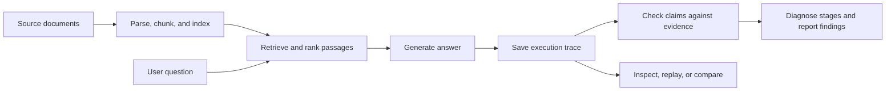

# X-RAG Diagnostic Framework

X-RAG is a research platform for retrieval-augmented generation (RAG). It searches a document collection, uses selected passages to answer a question, and records what happened so you can inspect the result.

The project uses Indian statutes and court judgments to study how document quality, retrieval, and answer generation affect each other. The dashboard lets you compare search strategies, inspect the evidence for an answer, and replay a saved run. The diagnostic pipeline checks individual claims and identifies which stage to investigate when it finds a problem.

## Quick start

Use Python 3.13 and Node.js 22.12 or later. Run these commands in PowerShell from the repository root.

```powershell
py -3.13 -m venv venv
.\venv\Scripts\python.exe -m pip install -r requirements.txt
Copy-Item .env.example .env
npm --prefix frontend ci
```

Set `NVIDIA_API_KEY` in `.env` for the default model provider. Keep your existing `.env` if you already have one. Put your source PDFs in `data/`, then build the default corpus index. Reuse the index if it already matches your documents.

```powershell
.\venv\Scripts\python.exe run_pipeline.py
```

Start the API and frontend in separate terminals from the repository root.

```powershell
# Terminal 1
.\venv\Scripts\python.exe run_api_ui.py

# Terminal 2
npm --prefix frontend run dev
```

Open the [dashboard](http://localhost:5173/). In **Chat**, select **Statutes** and ask a question about an indexed document. Enable **Deep analysis** to check the answer's claims. The API listens on port 8010.

If Vite reports `spawn EPERM` while loading its config in a restricted Windows session, start it with `npm --prefix frontend run dev -- --configLoader native`.

The first run can download model weights. Local models can run on a CPU. CUDA reduces verification time on compatible hardware. See the [GPU setup guide](docs/gpu_setup.md) and the [judgment corpus build steps](docs/COMPONENTS.md#reproducing-everything).

## High-level pipeline



1. **Prepare the documents.** Convert documents into passages. Store the passage text, its source, and a numerical representation for semantic search.
2. **Answer the question.** Find relevant passages, place them in the model prompt, and generate an answer with references to those passages.
3. **Record and check the run.** Save the prompt, evidence, answer, and execution data. Claim verification checks whether the evidence supports or contradicts each claim.
4. **Diagnose the result.** The full diagnostic pipeline uses the trace and claim verdicts to identify a likely cause and produce a report.

Chat streams the answer and saves a trace. Deep analysis adds claim and citation checks to the saved trace. The CLI runs the full stage diagnosis and builds a diagnostic report.

## Low-level pipeline

### 1. Ingest and index

[run_pipeline.py](run_pipeline.py) loads documents through [ingestion.py](src/ingestion.py). [chunk_engine.py](src/chunk_engine.py) splits the text and attaches provenance such as source file, page, and parent document ID when available. The [chunk registry](src/chunk_registry.py) maps each chunk ID to its text and metadata. The embedding engine encodes the chunks. The vector store publishes the embeddings to ChromaDB and writes the matching registry.

The default build writes `db/chroma/` and `artifacts/chunk_registry.json`. The judgments workflow has separate build steps for legal and fixed-size chunks and for the citation graph.

### 2. Retrieve and rank

[retriever.py](src/retriever.py) runs two searches in the default hybrid strategy. Dense search uses vector similarity to find passages with related meaning. BM25 ranks passages by keyword matches. Reciprocal rank fusion combines the two ranked lists.

The cross-encoder scores each question and candidate passage together. With the default [pipeline settings](configs/pipeline.py), up to 40 candidates from each search enter fusion, up to 20 fused candidates enter the reranker, and up to six reach the generator. A reranker can change which passages reach the generator only when it has more candidates than output positions.

[strategy_arms.py](src/strategy_arms.py) defines the strategy IDs used by chat and the experiments. Other strategies can repeat search with intermediate reasoning (IRCoT), use a bounded search controller, follow links in the citation graph, or look for conflicting evidence.

### 3. Generate and capture the trace

[chat_service.py](src/chat_service.py) can recall session memory and rewrite follow-up questions as standalone search queries. [generator.py](src/generator.py) builds the prompt from the selected evidence and conversation context. The [UI API](src/api_ui.py) streams progress and answer text to React through server-sent events.

[rag_trace.py](src/rag_trace.py) gives each execution a trace ID and saves it under `artifacts/rag_traces/`. The trace records the question, answer, prompt, retrieved passages, settings, and timing. New chat traces can also retain ranked candidates that did not reach the prompt. If memory is enabled, chat saves the interaction for later turns.

### 4. Verify claims and citations

[claim_decomposer.py](src/claim_decomposer.py) splits the answer into claims that can be checked separately. [claim_verifier.py](src/claim_verifier.py) uses natural language inference (NLI) to score whether an evidence passage supports, contradicts, or is neutral toward a claim. Thresholds map scores to verdicts. The configured verifier can use an LLM judge for ambiguous cases.

The evidence debugger also checks the specific passage that the answer cites. A claim can have support in one passage while its cited passage fails the support check. A verdict describes support in the available evidence. It does not establish that the claim is true outside that evidence.

### 5. Diagnose and report

[query.py](query.py) runs retrieval, generation, verification, and the full diagnostic pipeline. The [stage analyzer](src/pipeline_state_analyzer.py) assigns `PASS`, `FAIL`, or `UNKNOWN` to corpus, retrieval, chunking, generation, and grounding checks. The [root cause reasoner](src/root_cause_reasoner.py) uses the first failed stage in its configured causal order as the primary diagnosis. The [corrective action engine](src/corrective_action_engine.py) proposes changes, and the [report builder](src/report_builder.py) assembles the results.

A diagnosis depends on the signals captured in the trace. Use the reasoning and linked evidence to check it. The report shows where analysis is unavailable.

## Inspect and reproduce results

- **Debug.** Inspect the evidence for an answer, replay a trace with its saved passages, or run fresh retrieval against the current index. Use the **Strategy comparison arena** to compare methods on the same questions.
- **Reports.** Open saved HTML diagnostic reports. **Save Report** in Chat exports the session with its available trace and claim evidence. For a single trace with diagnostic JSON, use the [HTML report generator](scripts/generate_diagnostic_report.py).
- **Experiments.** Browse saved results for 13 studies, including fault injection, retrieval and generation comparisons, diagnosis accuracy, and external verifier validation. Check the run, sample size, and reference labels before comparing results. Some studies use injected faults or saved executions. See the [experiment implementations](experiments/) and the [design notes for E1–E5](docs/EXPERIMENTS.md).
- **Regression cases.** Save a failing answer as a case with expected evidence and answer checks. Run [the regression runner](scripts/run_regression_cases.py) to evaluate saved answers or regenerate them.

```powershell
# Run the full diagnostic pipeline on a question.
.\venv\Scripts\python.exe query.py "Your question"

# Render a single trace after the full diagnostic pipeline produces its report.
.\venv\Scripts\python.exe -m scripts.generate_diagnostic_report --trace-id YOUR_TRACE_ID

# Inspect the experiment runner options and validate regression fixtures.
.\venv\Scripts\python.exe -m experiments.run_all --help
.\venv\Scripts\python.exe -m scripts.run_regression_cases --validate
```

## Other entry points and documentation

| Entry point | Purpose |
| --- | --- |
| [run_api.py](run_api.py) | Diagnostic API for trace analysis and reports on port 8000 |
| [xrag/](xrag/) | Standalone evaluator for external traces with supplied evidence. Install from the repo with `python -m pip install .`, then try `xrag-evaluate examples/external_trace.json`. |
| [ui/app.py](ui/app.py) | Alternative Streamlit UI. Start it with `python -m streamlit run ui/app.py` from the configured Python environment. |

See the [component guide](docs/COMPONENTS.md) for design and trade-offs, the [semantic index](docs/SEMANTIC_INDEX.md) for code navigation, and the [test guide](docs/TEST_GUIDE.md) for validation commands. The [previous README](https://github.com/BharathGelivi/rag__capstone_latest/blob/acdc97a2e32e0a6fd33ed9b6f8b4e2f8753ac4f2/README.md) has the longer reference for local tooling, API examples, and benchmark setup.
